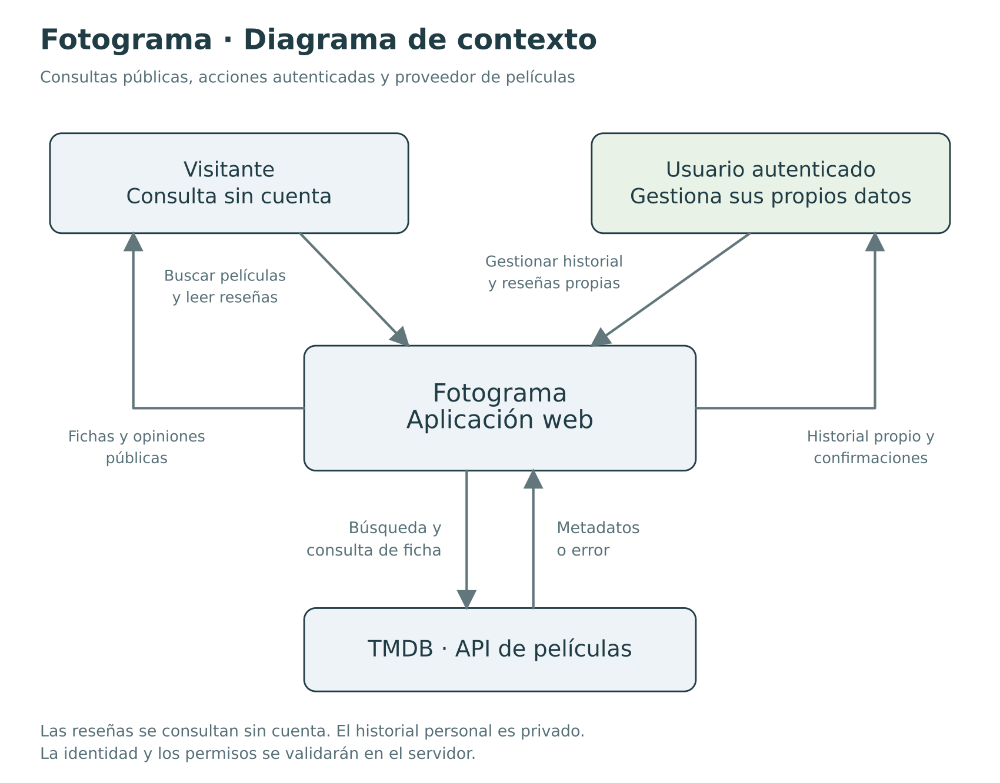
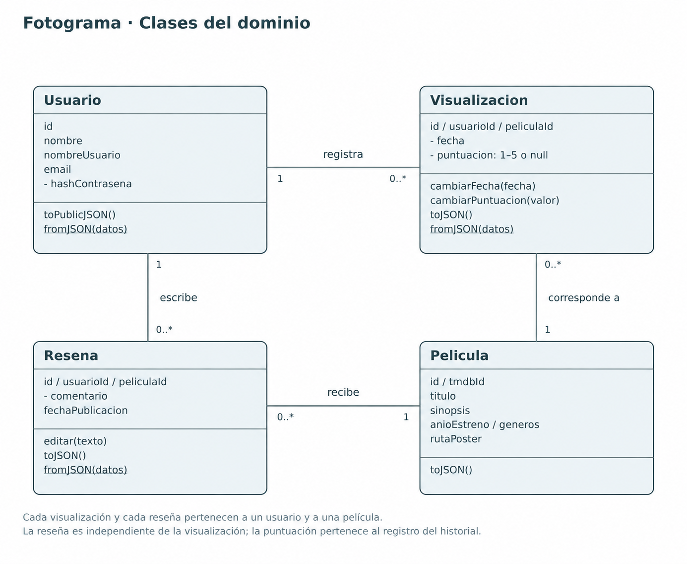
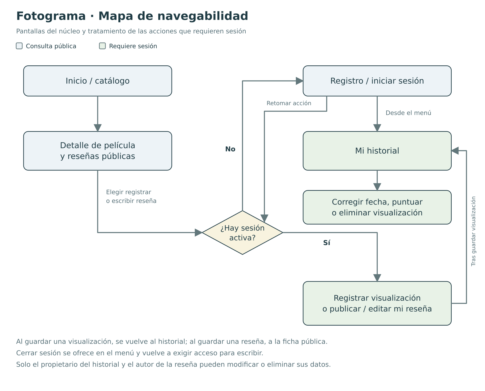
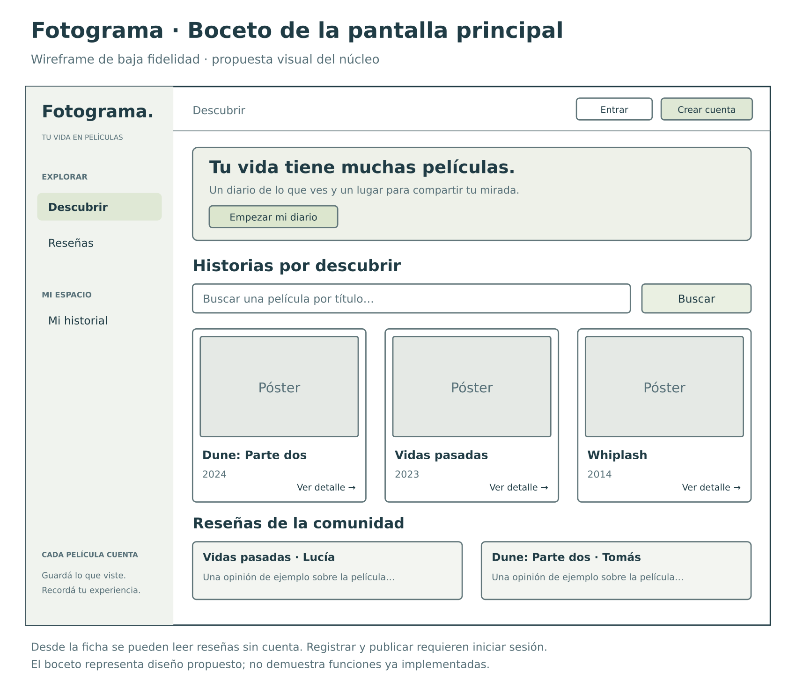

# Diseño de Fotograma

Diagramas y boceto del alcance general del proyecto. Se actualizan cuando cambian las decisiones de diseño.

## Contexto

Visitantes y usuarios autenticados pueden consultar películas y opiniones. La sesión habilita el registro de visualizaciones y la publicación de reseñas. TMDB aporta las fichas de películas.

## Clases del dominio

- Cada visualización y reseña se asocia a un usuario y una película.
- La puntuación pertenece a la visualización: es opcional y entera de 1 a 5.
- La reseña es independiente de la visualización. El historial es privado; las reseñas son públicas.
- `Pelicula` separa su `id` interno del `tmdbId` externo. Los registros usan `peliculaId`.
- Los métodos del modelo controlan los cambios de estado. `fromJSON` reconstruye instancias; `toPublicJSON` limita los datos públicos de `Usuario`.

La integración con TMDB se plantea mediante el [patrón Adapter](patron_elegido.md).

## Navegabilidad

Para registrar o reseñar sin sesión, primero se solicita el acceso y luego se retoma la acción. Cada usuario gestiona sus propios registros.

## Boceto de la pantalla principal

Inicio con catálogo, búsqueda por título y opiniones. El boceto representa una propuesta de interfaz. 
