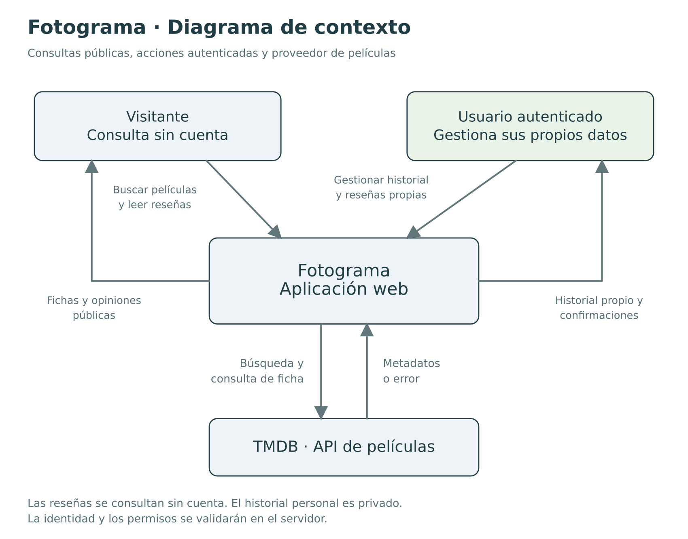
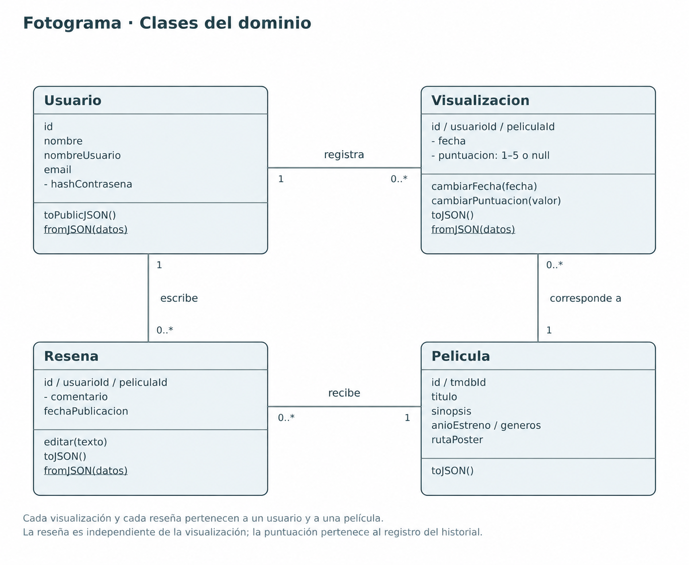
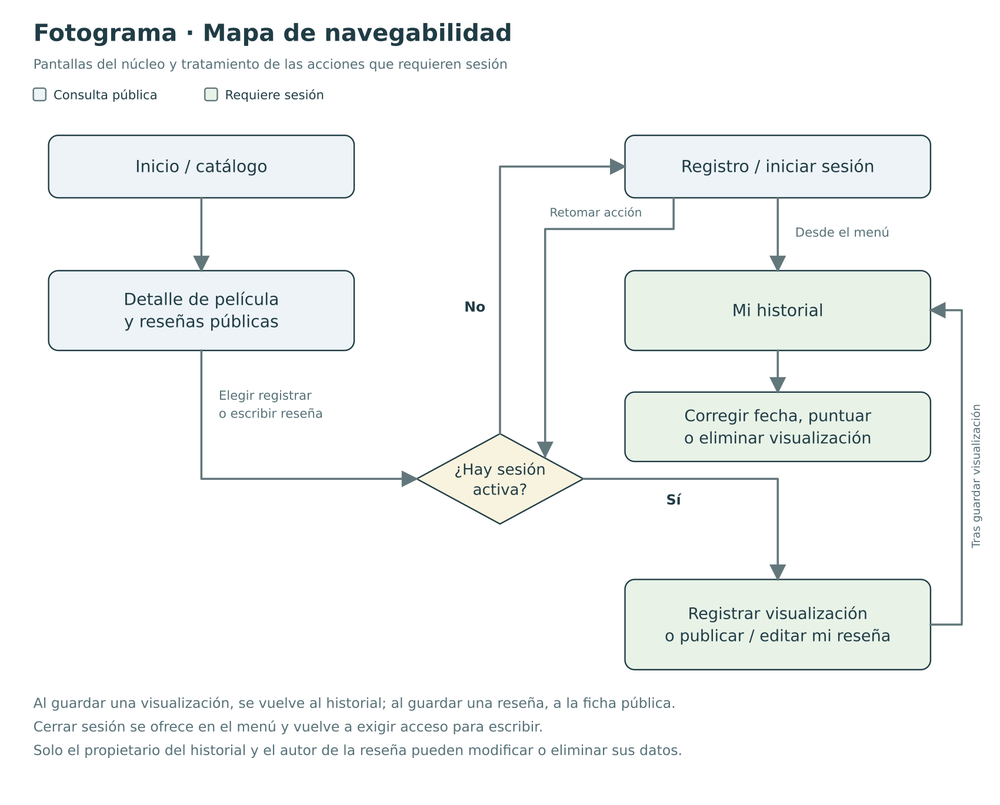
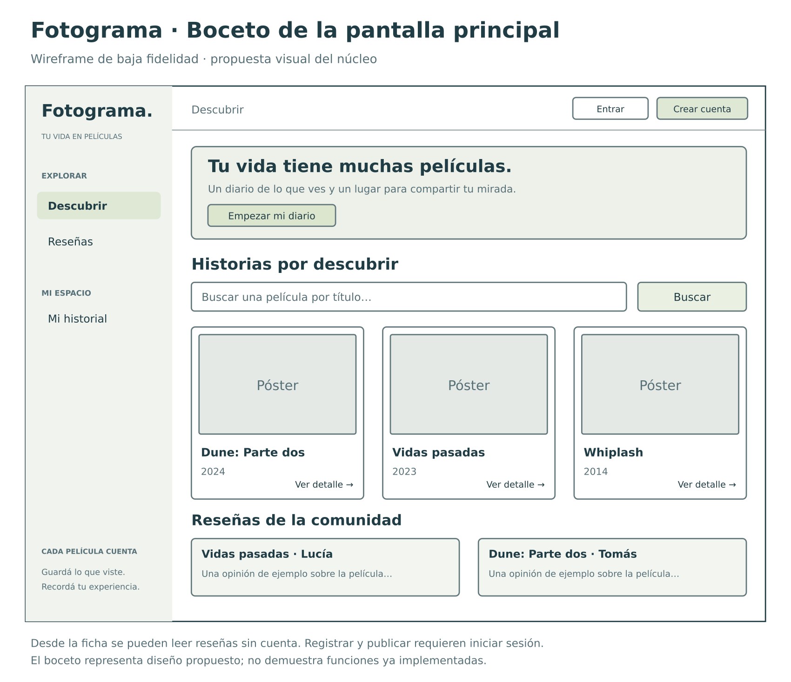

# Diseño de Fotograma

Diagramas y boceto del alcance general del proyecto. Se actualizan cuando cambian las decisiones de diseño.

El contrato de API acordado está en [contrato_api.md](contrato_api.md).

## Contexto

Visitantes y usuarios autenticados pueden consultar películas y opiniones. La sesión habilita el registro de visualizaciones y la publicación de reseñas. TMDB aporta las fichas de películas.

## Clases del dominio

- Cada visualización y reseña se asocia a un usuario y una película.
- La watchlist guarda películas pendientes de ver en una entrada por usuario y película; es privada y distinta de una visualización.
- La puntuación es única por usuario y película: se comparte entre visualización y reseña, es opcional, entera de 1 a 5, y cuenta en el promedio público de la ficha aunque no haya comentario.
- La existencia de la reseña es independiente de la visualización; la nota compartida se sincroniza entre ambas. El historial es privado; las reseñas son públicas.
- El perfil público muestra métricas derivadas de las reseñas, la selección de hasta cinco favoritas y una afinidad agregada con el visitante autenticado. La afinidad combina notas y favoritas. No expone visualizaciones, watchlist, email ni hash.
- `Pelicula` separa su `id` interno del `tmdbId` externo. Los registros usan `peliculaId`.
- Los métodos del modelo controlan los cambios de estado. `fromJSON` reconstruye instancias; `toPublicJSON` limita los datos públicos de `Usuario` y `toPrivateJSON` agrega el email para la propia cuenta.

La integración con TMDB se plantea mediante el [patrón Adapter](patron_elegido.md).

## Navegabilidad

Para registrar o reseñar sin sesión, primero se solicita el acceso y luego se retoma la acción. Cada usuario gestiona sus propios registros.

## Boceto de la pantalla principal

Inicio con catálogo, búsqueda por título y opiniones. El boceto representa una propuesta de interfaz. 
